# HustleHub+

HustleHub+ is a secure freelance marketplace. Clients browse and book freelancer gigs, freelancers create and manage gigs and track their income, and admins moderate the platform. It is a MERN application: an Express 5 API with MongoDB Atlas, and a React single-page frontend built with Vite. The API is served over HTTPS and enforces role-based access control on every request.

## Team members

| Name | Student number |
|---|---|
| Thabo Sestubi | ST10445734 |
| Sam Sossen | ST10445164 |
| Amaan Tesfaye | ST10287107 |
| Ethan Jansen | ST01440914 |

---

**Demonstration video:**
[[Video Presentation](https://youtu.be/p6hxguUb1oU)]()

---

## Features

| Role | Can do |
|---|---|
| Client | Browse, search and filter gigs; book gigs; view own bookings |
| Freelancer | Create, edit, hide (mark inactive) and delete own gigs; view bookings received; view transactions and total income |
| Admin | View all users and all gigs (including hidden ones); delete any gig. The admin account is created with a setup script, not the register page. |

Every booking automatically creates a transaction linked to the client, freelancer and gig. Only clients can book, clients cannot book inactive gigs, and the server looks up the price itself, so it cannot be changed from the browser.

| Page | Route | Who can open it | API used |
|---|---|---|---|
| Register | `/register` | Logged-out users | `POST /api/auth/register` |
| Log in | `/login` | Logged-out users | `POST /api/auth/login` |
| Dashboard | `/` | All logged-in users | – |
| Profile | `/profile` | All logged-in users | `GET /api/auth/profile` |
| Browse gigs (search, filter, sort) | `/gigs` | All logged-in users | `GET /api/gigs` |
| Gig detail and booking | `/gigs/:id` | All logged-in users (only clients can book) | `GET /api/gigs/:id`, `POST /api/bookings` |
| My gigs | `/gigs/mine` | Freelancers | `GET /api/gigs/mine` |
| Create / edit gig | `/gigs/new`, `/gigs/:id/edit` | Freelancers (edit: owner only) | `POST /api/gigs`, `PUT /api/gigs/:id` |
| My bookings | `/bookings` | Clients and freelancers | `GET /api/bookings/my`, `GET /api/bookings/freelancer/my` |
| Income | `/income` | Freelancers | `GET /api/transactions/income`, `GET /api/transactions/my` |
| Admin (all gigs and users) | `/admin` | Admins | `GET /api/admin/gigs`, `GET /api/admin/users`, `DELETE /api/gigs/:id` |

The navigation menu only shows the links the logged-in user's role is allowed to use.

---

## Gig management and role-based access control (RBAC)

Authentication proves **who** a user is. Authorisation decides **what** that user may do. Every rule below is enforced in the backend API, so hiding a button in the React interface is never the only protection (OWASP Foundation, n.d.-a).

### Roles

| Role | Can do | Cannot do |
|---|---|---|
| **Client** | Browse and view active gigs. Book gigs. View own bookings. | Create, edit or delete gigs. View "my gigs". Use admin endpoints. |
| **Freelancer** | Create gigs. View, edit, pause and delete **their own** gigs. Browse other freelancers' active gigs. View bookings and income. | Edit or delete another freelancer's gig. View another freelancer's paused gig. Book gigs. Use admin endpoints. |
| **Admin** | View every gig (including paused) and every user. Delete any gig for moderation. | Create gigs. Edit gigs. Register through the public API. |

The role is stored on the user and signed into the JWT at login (`{ id, email, role }`). It is read from the verified token on every request and never from the request body, query string or headers, so a user cannot grant themselves a role. Public registration only accepts `client` or `freelancer`. Admin accounts are created on the server with a script (see Setup).

### Gig endpoints

All routes require `Authorization: Bearer <token>`.

| Method | Route | Allowed roles | Ownership rule | Purpose |
|---|---|---|---|---|
| `GET` | `/api/gigs` | client, freelancer, admin | n/a | Browse active gigs (paginated, filterable) |
| `GET` | `/api/gigs/mine` | freelancer | Own gigs only | List own gigs, including paused |
| `GET` | `/api/gigs/:id` | client, freelancer, admin | Paused gigs: owner or admin only | View one gig |
| `POST` | `/api/gigs` | freelancer | Owner set from the token | Create a gig |
| `PUT` | `/api/gigs/:id` | freelancer | Must own the gig | Replace a gig's editable fields |
| `PATCH` | `/api/gigs/:id` | freelancer | Must own the gig | Change some fields (for example pause a gig) |
| `DELETE` | `/api/gigs/:id` | freelancer, admin | Freelancer must own it. Admin may delete any | Delete a gig |
| `GET` | `/api/admin/users` | admin | n/a | List users (no password hashes) |
| `GET` | `/api/admin/gigs` | admin | n/a | List all gigs including paused, with the freelancer's email |

**Browse filters** (`GET /api/gigs`): `page`, `limit` (1 to 50, default 12), `category`, `q` (search title and description), `minPrice`, `maxPrice`, `sort` (`newest`, `price_asc`, `price_desc`).

**Gig fields**

| Field | Rule |
|---|---|
| `title` | Text, 5 to 100 characters, no `<` or `>` |
| `description` | Text, 20 to 1000 characters, no `<` or `>` |
| `price` | Number (not text), from 1 to 1 000 000 Rand, at most 2 decimal places |
| `category` | One of: Design, Development, Writing, Marketing, Video & Animation, Music & Audio, Business, Other |
| `isActive` | Optional boolean (default `true`). `false` pauses the gig |
| `freelancer` | **Not accepted from the client.** Set from the JWT and immutable afterwards |

### How a request is checked

Each route runs its checks in a fixed order and stops at the first failure:

```text
JWT valid?          -> no: 401
Role allowed?       -> no: 403  "Access denied: insufficient permissions"
:id well formed?    -> no: 400
Gig exists?         -> no: 404
Caller owns gig?    -> no: 403  "Access denied: You do not own this gig"
Body valid?         -> no: 400  (lists each field and its message)
Action performed
```

| Status | Meaning in this API |
|---|---|
| `400` | Input failed validation. The response lists each field and a message |
| `401` | Not authenticated: no token, or an invalid, expired or tampered token |
| `403` | Authenticated, but this role or this user is not allowed to do this |
| `404` | The gig does not exist, or is paused and the caller may not see it |

Errors return a controlled JSON message. They never include stack traces, database errors or the value the user submitted.

The checks are small reusable middleware:

| File | Responsibility |
|---|---|
| `api/middleware/authMiddleware.js` | `verifyToken`: verifies the JWT and attaches `req.user` |
| `api/middleware/roleMiddleware.js` | `authorizeRoles(...roles)`: role check |
| `api/middleware/gigOwnership.js` | `loadGig`, `requireGigOwnership`, `requireGigOwnershipOrAdmin`: ownership checks |
| `api/middleware/validateGigInput.js` | Field rules, unknown-field rejection, id and query validation |
| `api/controllers/gigController.js`, `api/controllers/adminController.js` | Gig and admin logic |
| `api/models/Gig.js` | Gig schema |

### Design decisions

- **Ownership is checked on the server for every request.** `PUT`, `PATCH` and `DELETE` first load the gig and compare its `freelancer` to the id in the verified token. This stops one user changing another user's data by guessing a gig id (broken access control).
- **The owner always comes from the token.** The create and update routes reject any body containing `freelancer`, `role`, `_id` or any other field outside the allow-list, which prevents mass-assignment attacks. The `freelancer` field is also `immutable` in the schema, so a gig can never be transferred to another user.
- **403 for someone else's gig, 404 for a gig you may not see.** Active gigs are public listings, so telling a user "this exists but is not yours" leaks nothing. A paused gig is private to its owner and admins, so everyone else gets the same 404 as for a gig that does not exist.
- **Admins moderate; they do not trade.** An admin can list everything and delete any gig, but cannot create or edit gigs. This keeps the three roles clearly separate.
- **Least information.** Browse responses show only the freelancer's id and display name, never their email. Password hashes are never returned. The `403` response does not reveal which roles would have been accepted.
- **Query input cannot reach the database as operators.** Every query parameter is type-checked (so `?category[$ne]=x` cannot become a MongoDB operator), and search text is escaped so characters such as `.*` are matched literally.
- **Known trade-off.** The role is read from the signed JWT. If an admin changed a user's role, the old token would keep its old role until it expires (1 hour). A short expiry limits this window.

---

## Running the backend and frontend

### Prerequisites

- Node.js 22 and npm
- Access to the team's MongoDB Atlas cluster (your IP must be allowed under Network Access)
- Git Bash (for OpenSSL)

### Setup

1. Copy `.env.example` to `.env` in the **project root** and fill in the real values (`MONGO_URI`, `JWT_SECRET`, `ADMIN_PASSWORD`). `ADMIN_PASSWORD` needs 8 to 72 characters with an upper case letter, a lower case letter and a number.
2. Create the local HTTPS certificate in the project root (Git Bash):

```bash
mkdir certs
openssl req -x509 -newkey rsa:2048 -nodes -sha256 -days 825 -keyout certs/localhost-key.pem -out certs/localhost-cert.pem -subj "/CN=localhost" -addext "subjectAltName=DNS:localhost,IP:127.0.0.1"
```

3. Install the packages:

```bash
cd api
npm install
cd ../client
npm install
cd ..
```

> On Windows PowerShell, if `npm` is blocked, use `npm.cmd` instead.

4. Create the admin account (once, from the **project root**):

```bash
node api/scripts/createAdmin.js
```

   It prints `Admin admin@hustlehub.local created`. Log in with that email and your `ADMIN_PASSWORD`. Running it again prints `already exists` and changes nothing. Set `ADMIN_EMAIL` or `ADMIN_NAME` in `.env` to use different details.

### Start the app

1. Start the API from the **project root** (so it finds `.env` and `certs`):

```bash
node api/server.js
```

   Wait for `MongoDB connected.`

2. In a second terminal, start the frontend:

```bash
cd client
npm run dev
```

3. Open `http://localhost:5173`. Press `Ctrl + C` in each terminal to stop.

### How the frontend reaches the API

During development, Vite's dev server forwards every request starting with `/api` to `https://localhost:4000` (see `vite.config.js`). The browser only ever talks to `localhost:5173`, so no cross-origin (CORS) requests are made. The proxy uses `secure: false` only because the API uses a self-signed development certificate; the connection to the API is still encrypted.

### Other commands

| Command | What it does |
|---|---|
| `npm run lint` (client) | Checks the code with ESLint |
| `npm test` (client) | Runs the frontend tests |
| `npm run test:evidence` (client) | Runs the frontend tests with a full list of results |
| `npm run build` (client) | Creates a production build in `dist/` |
| `npm test` (api) | Runs the backend Jest tests |
| `npm run test:api` (api) | Runs the Postman collection with Newman (API must be running) |

---

## Project structure

```text
api/
├── config/        # Helmet/CSP and CORS settings
├── controllers/   # auth, gigs, admin, bookings, transactions
├── middleware/    # JWT, roles, gig ownership, validation, sanitiser, rate limiters, error handler
├── models/        # User, Gig, Booking, Transaction
├── routes/        # one router per area
├── scripts/       # createAdmin.js
├── utils/         # password hashing, response serialisers
├── __tests__/     # backend Jest tests
└── server.js      # middleware order and HTTPS server

client/src/
├── api/          # apiRequest helper and one module per backend area (auth, gigs, bookings, admin)
├── auth/         # session storage helpers and role constants
├── components/   # NavBar, route guards, GigCard, GigForm, FormError
├── context/      # AuthProvider and useAuth (shared login state)
├── hooks/        # useApi (loading, errors and logout on expired session)
├── pages/        # one component per page, with its tests alongside
├── test/         # Jest setup, test helpers and sample data
├── utils/        # validation and formatting helpers
├── App.jsx       # routes and role rules
└── navigation.js # which menu links each role can see

postman/          # Postman collection and environment
docs/evidence/    # Newman, ZAP and npm audit evidence
```

---

## Security measures

| Threat | Protection |
|---|---|
| Stolen passwords | Passwords hashed with bcrypt (12 rounds); never stored or returned in plain text |
| Forged or tampered tokens | JWT (HS256) checked on every protected route, with algorithm, issuer and audience pinned; tokens expire after 1 hour |
| Users acting outside their role or on others' data | Role checks on every route and ownership checks on gigs (403 if not allowed) |
| Mass assignment (setting your own role or owner) | Allow-listed request fields; the owner and role come from the token only |
| Invalid or malicious input | Validation on every route; names and gig text cannot contain `<` or `>` |
| NoSQL injection and prototype pollution | Sanitiser blocks `$` and `.` in field names, `__proto__`/`constructor`, and deeply nested data; query parameters are type-checked |
| Brute-force login and spam | Rate limits: login 5 failed attempts / 15 min, register 10 / hour, bookings 5 / 15 min, whole API 300 / 15 min; clear `429` message with retry time |
| Password guessing spread across many IP addresses | Account lockout stored on the account: locked after 5 failures, each lock twice as long (see [Own security features](#own-security-features-part-3)) |
| Stolen or leaked passwords | Optional two-factor authentication (TOTP); 2FA secrets encrypted with AES-256-GCM (see [Own security features](#own-security-features-part-3)) |
| XSS, clickjacking and other browser attacks | Helmet with a strict Content Security Policy (`default-src 'none'`, `frame-ancestors 'none'`), HSTS, `nosniff`, `X-Frame-Options: DENY`, `no-referrer`; `X-Powered-By` hidden |
| Other websites calling the API | CORS only allows the React app's origin |
| Large or broken requests | 10 kb body limit; clear errors for invalid JSON |
| Leaking internal details | One central error handler sends safe messages only; details are logged on the server |
| Data read in transit | API served over HTTPS |
| Secrets in GitHub | `.env` and certificates are ignored by Git; `.env.example` lists the settings with placeholder values |

An OWASP ZAP scan of the running API found 0 high and 0 medium risk alerts (`docs/evidence/HustleHub_ZAP_Security_Report.html`).

## Frontend security notes

- **Token storage:** the JWT is kept in `sessionStorage`, which is cleared when the tab closes, rather than `localStorage`, which persists across sessions. This limits how long a stolen token stays useful. Tokens also expire after one hour, and the app logs the user out automatically when the token expires. An httpOnly cookie would be stronger, because JavaScript could not read it at all, and is noted as future work.
- **Role-based access:** menus and route guards (`ProtectedRoute`) only control what the user **sees**. Every request carries the signed JWT, and the API's role and ownership checks decide what the user can **do**, so editing values in the browser cannot bypass access control.
- **Safe error messages:** all requests go through `apiRequest` (`src/api/client.js`), which turns failures into friendly messages. Server errors (5xx) never show the server's text, and field errors from the API are filtered before display, so internal details are not exposed.
- **Validation:** client-side validation mirrors the backend rules (password rules, gig title, description and price limits) to give quick feedback. It is for usability only; the API validates every request again.
- **Not trusting the client:** a booking request sends only the gig ID. The server looks up the price, client and freelancer itself, so a user cannot change the price in the browser.
- **XSS:** React escapes all text it renders, and the app never uses `dangerouslySetInnerHTML`. Gig text containing `<` or `>` is rejected.

---

## Own security features (Part 3)

Two security features were added in Part 3 that go beyond the Part 1 and Part 2 requirements: **account lockout with progressive delay** and **two-factor authentication (2FA)**. They work together: wrong 2FA codes count towards the same lockout as wrong passwords.

### 1. Account lockout with progressive delay

**Threat mitigated:** online password guessing (brute force and credential stuffing) against a single account. The Part 2 login rate limiter counts failed attempts per IP address and email, and keeps its counts in memory. An attacker who spreads guesses across many IP addresses, or waits for a server restart, gets around it. OWASP recommends locking an account after a number of failed attempts, and NIST requires the number of consecutive failed attempts on one account to be limited (OWASP Foundation, n.d.-b; Grassi et al., 2017).

**How it works:**

- Each wrong password (or wrong 2FA code) adds 1 to a counter **stored on the account in MongoDB**, so the count follows the account whatever IP address the attempts come from, and survives a restart.
- After **5** failures in a row the account is locked, and the API answers `423 Locked` with a `Retry-After` header and the number of seconds left.
- **Progressive delay:** each new lock lasts twice as long as the one before: 15 minutes, 30 minutes, 1 hour, 2 hours, up to a cap of 4 hours. A determined attacker is slowed down more and more, while a real user who mistypes is only briefly delayed.
- While the account is locked, the password is **not checked at all**, so even the correct password is refused and guessing during a lock is pointless.
- Failures older than 15 minutes are forgotten, and a successful login clears everything, so occasional typos never lock anyone out.
- The counters are updated with **atomic database operations**. Twelve wrong passwords sent at the same moment still apply exactly one lock and cannot slip extra guesses through.
- The lockout fields are hidden from normal queries (`select: false`), so they are never returned by the API.
- The login page shows a live countdown and disables the button until the lock ends.

| Setting (`.env`) | Default | Meaning |
|---|---|---|
| `LOCKOUT_MAX_ATTEMPTS` | 5 | Failures before the account is locked |
| `LOCKOUT_BASE_MINUTES` | 15 | Length of the first lock |
| `LOCKOUT_MAX_MINUTES` | 240 | Longest a lock can last |
| `LOCKOUT_RESET_MINUTES` | 15 | Failures older than this are forgotten |

**Design decision:** a wrong password always gets the same `401 Invalid email or password` message and never says how many attempts are left, because that would let an attacker tell real accounts from fake ones. The trade-off is that the `423` response does reveal that a locked account exists; this was accepted because the user needs to know why they cannot log in.

**Code:** `api/utils/accountLockout.js`, `api/controllers/authController.js`, `client/src/pages/LoginPage.jsx`

### 2. Two-factor authentication (TOTP)

**Threat mitigated:** account takeover with a stolen, leaked or guessed password. With 2FA on, the password alone is not enough to log in: the user must also enter a 6-digit code from an authenticator app on their phone (OWASP Foundation, n.d.-c).

**How it works:** HustleHub+ uses TOTP, the time-based one-time password standard used by Google Authenticator, Microsoft Authenticator and Authy. The server and the app share a secret, and each turns "secret + current time" into the same 6-digit code, which changes every 30 seconds (M'Raihi et al., 2011).

**Turning it on (Profile page):**

1. `POST /api/auth/2fa/setup` creates a new 160-bit secret, as RFC 4226 recommends (M'Raihi et al., 2005), and returns it as a QR code to scan. It is saved only as *pending*.
2. The user enters a code from the app. `POST /api/auth/2fa/enable` checks it, and only then does the pending secret become active. A setup that is never finished cannot lock anyone out.
3. Turning it off (`POST /api/auth/2fa/disable`) needs **both the password and a current code**, so someone at an unlocked, logged-in computer cannot quietly remove the protection.

**Logging in with 2FA on:**

```
Step 1  POST /api/auth/login        email + password       -> challenge token (valid 5 minutes), no JWT
Step 2  POST /api/auth/2fa/verify   challenge token + code  -> normal JWT
```

**Security details:**

| Protection | Why it matters |
|---|---|
| **Secrets encrypted at rest** with AES-256-GCM, a random IV for every encryption and an authentication tag (Dworkin, 2007) | A leaked database does not leak working 2FA secrets, and a stored value that has been tampered with is rejected |
| **Encryption key only in `.env`** (`TWO_FACTOR_ENCRYPTION_KEY`) | The key never sits in the database or the code |
| **Challenge token is not a login token** (its own audience, 5-minute expiry) | Knowing the password gives no access to any other route |
| **Used codes cannot be replayed** | A code seen over someone's shoulder cannot be used again, even within its 30 seconds, as RFC 6238 requires (M'Raihi et al., 2011) |
| **Wrong codes count towards the account lockout** | 5 wrong codes lock the account, so the code cannot be brute forced |
| **A correct password does not reset the failure counter** while 2FA is on | An attacker who knows the password cannot log in again to reset the counter and keep guessing codes |
| **Rate limited:** 10 wrong codes per 15 minutes per account | A second layer against guessing |
| **One code window either side is accepted** | A phone clock that is slightly off still works |
| **Optional per user**, off by default | Existing accounts and the Postman test accounts are unaffected |

**Code:** `api/utils/twoFactor.js`, `api/utils/secretEncryption.js`, `api/utils/twoFactorChallenge.js`, `api/controllers/twoFactorController.js`, `client/src/components/TwoFactorSettings.jsx`, `client/src/pages/LoginPage.jsx`

**Encryption key:** generate one with `node -e "console.log(require('crypto').randomBytes(32).toString('hex'))"`. If it is not set, a separate key is derived from `JWT_SECRET` with HKDF, so the app still works in development and CI. Every machine that uses the same database must use the same key, and the key must not change once users have 2FA on.

### Testing the security features

| Test | Where | What it proves |
|---|---|---|
| 17 Jest tests | `api/__tests__/accountLockout.test.js` | Lock after 5 failures, doubling lock length and cap, old failures forgotten, one lock from 12 simultaneous attempts, correct password refused while locked, reset after a successful login, no lockout data in responses |
| 9 Jest tests | `api/__tests__/secretEncryption.test.js` | Secrets round-trip, are never stored in plain text, look different every time, and tampered values or the wrong key are rejected |
| 29 Jest tests | `api/__tests__/twoFactor.test.js` | Valid, old, wrong, reused and malformed codes; challenge token cannot be used as a JWT and the reverse; setup stores the secret encrypted; enable and disable rules; full two-step login; 5 wrong codes lock the account |
| 16 React tests | `LoginPage.test.jsx`, `TwoFactorSettings.test.jsx` | Lockout countdown, code step at login, wrong and expired codes, QR code setup, turning 2FA on and off |
| 19 Postman requests (41 assertions) | Folder **Own Security Features** in the collection | Against the running API: a throwaway account is locked on the 5th wrong password; a second throwaway account turns 2FA on with real codes generated by the collection, logs in with a code, and has a reused code refused |

The Postman tests use new throwaway accounts on every run, so the fixed test accounts are never locked or put behind 2FA. Because reused codes are refused, the 2FA requests sometimes wait up to 30 seconds for a fresh code, so a full Newman run takes about a minute.

### How to try it

1. Log in, open **Profile**, and choose **Turn on two-factor authentication**.
2. Scan the QR code with an authenticator app and enter the 6-digit code.
3. Log out and log in again: after the password, the app asks for the code.
4. To see the lockout, enter a wrong password 5 times: the login page shows a 15-minute countdown.

---

## Frontend testing

The frontend is tested with **Jest** and **React Testing Library**. Tests run in a simulated browser (jsdom), and API calls are mocked so the frontend can be tested on its own, quickly and repeatably. The real API is tested separately with Postman and Newman.

### Running the tests

```bash
cd client
npm test
```

**Result:** 12 test suites, 80 tests, all passing.

The full test output is saved in `client/test-evidence/frontend-test-results.txt` (generated with `npm run test:evidence`).

### What is tested

| Test file | Tests | What it checks |
|---|---|---|
| `utils/validation.test.js` | 12 | Login and registration rules, password rules, admin role not allowed at registration |
| `api/client.test.js` | 8 | Token sent as a Bearer header, safe messages for 400/401/429/500, server unreachable |
| `pages/LoginPage.test.jsx` | 12 | Rendering, empty-form validation without an API call, successful login, wrong-password message, lockout countdown and unlock, 2FA code step (correct, wrong and expired codes, lockout, back button) |
| `components/TwoFactorSettings.test.jsx` | 8 | 2FA off by default, QR code setup, 6-digit code box, turning 2FA on, wrong and short codes, turning 2FA off needs password and code, wrong password does not log out |
| `pages/RegisterPage.test.jsx` | 4 | Role options, weak password, successful registration, duplicate email |
| `App.test.jsx` | 10 | Menu per role, logout, redirect when logged out, "Not allowed" for wrong role, expired session, return to requested page after login |
| `pages/GigsPage.test.jsx` | 3 | Gigs shown from the API, search/category/sort sent correctly, empty results |
| `pages/GigDetailPage.test.jsx` | 6 | Client booking (only the gig ID is sent), rate-limit message, owner vs non-owner buttons, delete, gig not found |
| `pages/GigFormPage.test.jsx` | 5 | Validation before the API call, price sent as a number, server field errors, editing, editing someone else's gig refused |
| `pages/BookingsPage.test.jsx` | 3 | Client and freelancer views use the right endpoint, empty state |
| `pages/IncomePage.test.jsx` | 2 | Total income and transactions, empty state |
| `pages/AdminPage.test.jsx` | 7 | Admin sees all gigs with owner emails, users tab shows no password data, delete asks first and refreshes, cancel deletes nothing, clients and freelancers are blocked from `/admin`, the Admin menu link is shown only to admins |

The tests use both **rendering tests** (checking what appears on screen) and **user interaction tests** (simulating typing and clicking with `user-event`). Elements are found by their label or role, the way a user finds them, which also checks that forms are accessible.

### A bug found by the tests

When a logged-out user opened a protected page, was redirected to log in and then logged in, they were taken to the dashboard instead of the page they had requested. `PublicOnlyRoute` redirected to `/` as soon as the session was saved, before the login page could redirect. It now redirects to the saved destination, and a test covers this.

## Backend testing

### Jest

The booking and transaction logic, the account lockout and two-factor authentication have Jest tests that mock the database models.

```bash
cd api
npm test
```

**Result:** 6 test suites, 80 tests, all passing (`booking`, `bookingHistory`, `transaction`, `accountLockout`, `secretEncryption`, `twoFactor`).

### Postman and Newman

The API is tested with a Postman collection covering success and failure cases: registering and logging in, creating and updating gigs, booking (and checking a transaction is created), income, blocked actions for the wrong role (403), NoSQL injection (400), a fake token (401), security headers, and rate limiting (429).

- Collection: `postman/HustleHub.postman_collection.json`
- Environment: `postman/HustleHub.postman_environment.json`

To run it (with the API running in another terminal):

```bash
cd api
npm run test:api          # results in the terminal
npm run test:api:report   # also saves postman/reports/newman-report.html
```

**Result:** 22 requests, 30 assertions, 0 failures.

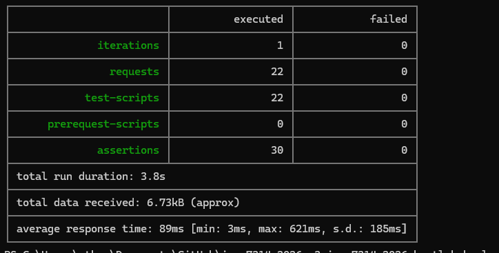

### npm audit

`npm audit` found 3 vulnerabilities in the API's production packages (1 critical). All were fixed with `npm audit fix`, leaving 0. The client had 0. The remaining warnings are only in development tools (Newman, Jest, Nodemon), which do not run in the app itself. Full reports are in `docs/evidence/`.

---

## Integration notes

While connecting the frontend to the backend and reviewing the code:

- The gig ownership check compared `user._id`, but the JWT stores the user's ID as `id`, so owners could not edit or delete their own gigs. This was fixed in `api/middleware/gigOwnership.js`.
- The gig request validator allowed titles of 3–100 characters and descriptions of 10–2000, but the Gig model requires 5–100 and 20–1000. The validator now matches the model, so API errors and the frontend rules agree, and a database validation error returns the field messages instead of a generic failure.
- The admin setup script had a misspelt model path and its log messages were written with single quotes instead of backticks. Both were fixed, and it now runs correctly with `node api/scripts/createAdmin.js`.
- The Jest configuration key `testTimeout` was misspelt, so it was ignored. It is now correct.

---

## Changes since Part 1

- Moved from a basic auth API to a full-stack MERN app with MongoDB
- Added gigs, bookings, transactions and income tracking
- Added role-based access control, gig ownership checks and admin routes
- Added the admin moderation page (all gigs, users, delete any gig)
- Added the React frontend with role-based navigation
- Added security: Helmet with a strict CSP, CORS, input sanitisation, a body size limit, stronger JWT checks, rate limiting with clear 429 responses, and a central error handler
- Removed secrets and certificates from Git and added `.env.example`
- Added automated testing: Postman/Newman API tests, Jest backend and frontend tests, and npm audit
- Rewrote the README and committed the Postman collection (Part 1 feedback)

---

## Tax and Income Dashboard

The Income page (`/income`, freelancers only) shows a freelancer's earnings from completed transactions and an estimate of the South African income tax (SARS) on them for th current tax year.

### What it shows

| Item | Meaning |
|---|---|
| Gross income | Sum of the freelancer's `completed` transactions in the tax year |
| Estimated tax | SARS tax on that income after the primary rebate |
| Net income | Gross income minus estimated tax |
| Effective tax rate | Estimated tax divided by gross income |
| Income by month (bar chart) | Completed income for each month from March to February |
| Net income and tax (stacked bar) | How gross income splits into net income and tax |

### Methodology

1. **Tax year.** SARS tax years run from 1 March to the end of February. The 2026/27 year is 1 March 2026 to 28 February 2027, using South African time (UTC+2). An optimal `?taxYear=2027` qquery parameter selects the year the tax year ends in.
2. **Income.** The API adds up the `amount` of the logged-in freelancer's `completed` transactions inside the tax year and groups them by month (calculated in the `Africa/Johannesburg` time zones).
3. **Tax.** The gross income is treated as the annual taxable income and passed through the progressive SARS brackets below. The primary rebate is subtracted and the result cannot go below zero.
4. **Rates.** Effective rate = estimated tax ÷ gross income × 100. The marginal rate is the rate of the bracket the income falls in (0% at or below the tax threshold).

### SARS 2026/27 rates used

| Taxable income (R) | Tax (R) |
|---|---|
| 1 – 245,100 | 18% of taxable income |
| 245,101 – 383,100 | 44,118 + 26% of amount above 245,100 |
| 383,101 – 530,200 | 79,998 + 31% of amount above 383,100 |
| 530,201 – 695,800 | 125,599 + 36% of amount above 530,200 |
| 695,801 – 887,000 | 185,215 + 39% of amount above 695,800 |
| 887,001 – 1,878,600 | 259,783 + 41% of amount above 887,000 |
| 1,878,601 and above | 666,339 + 45% of amount above 1,878,600 |

- **Primary rebate:** R17,820 (applies to every individual).
- **Tax threshold (under 65):** R99,000. Below this no tax is payable, because the tax before rebate is smaller than the rebate.

### Formula

```
taxBeforeRebate = base + rate × (income − bracketLowerLimit)
estimatedTax    = max(0, taxBeforeRebate − 17 820)
netIncome       = income − estimatedTax
effectiveRate   = estimatedTax ÷ income × 100
```

---
## Screenshots

Booking confirmed:
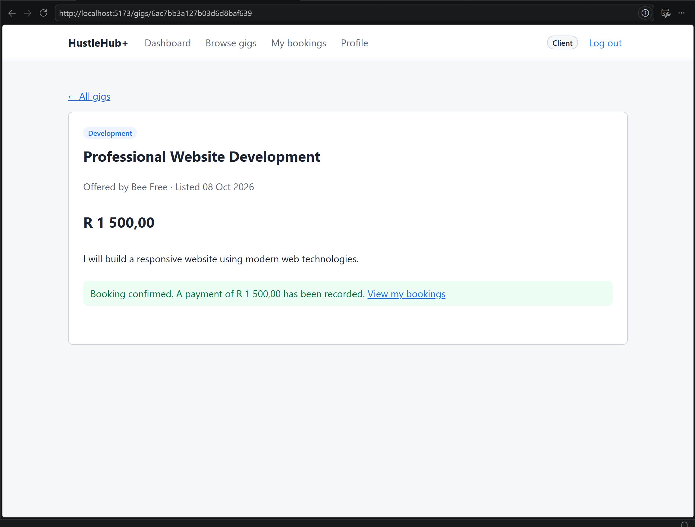

Browse Gigs:
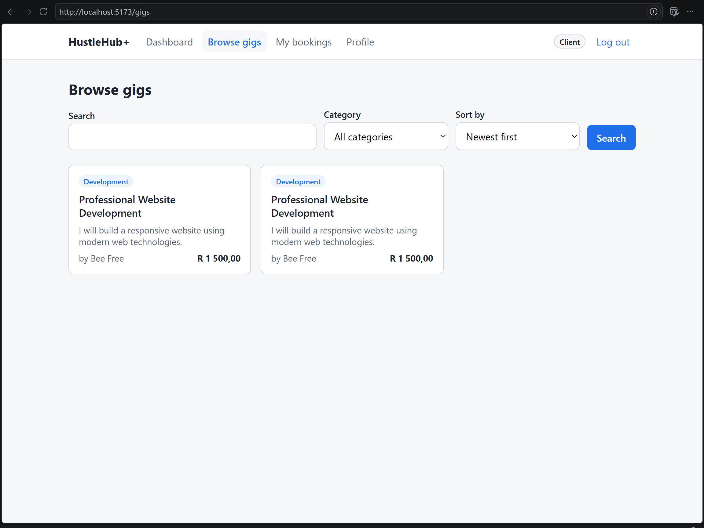

Client bookings:
 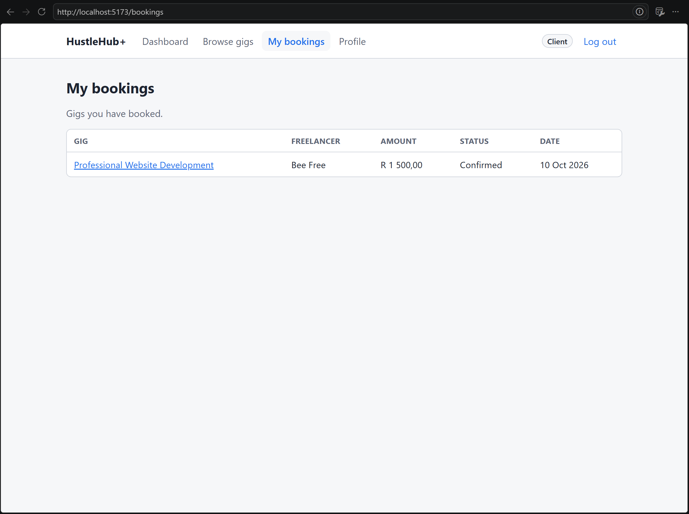

Client dashboard:
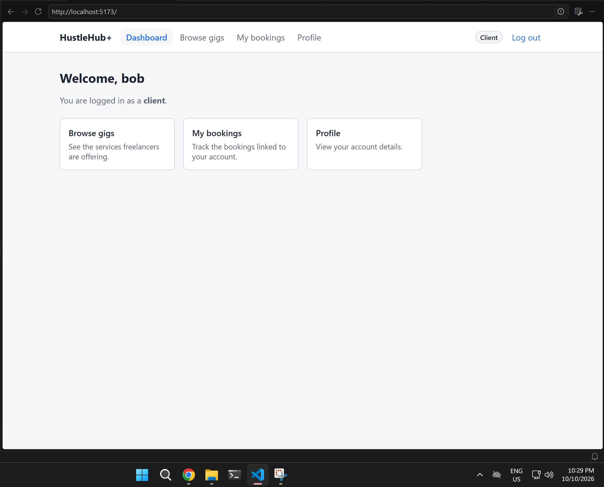 

Create gig validation:
 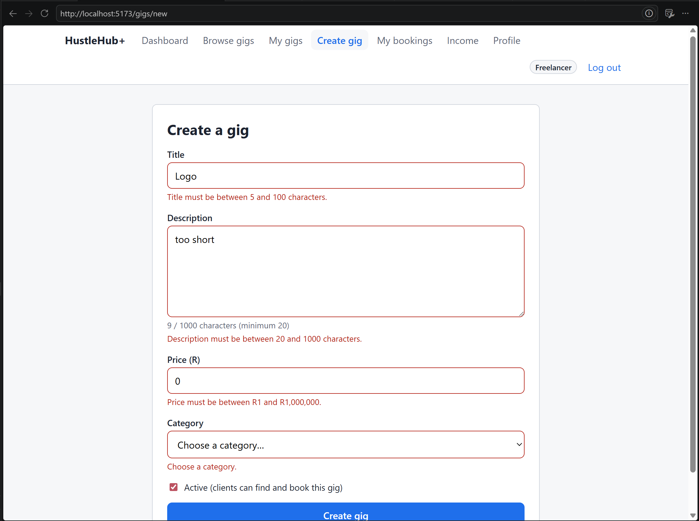

Freelancer dashboard:
 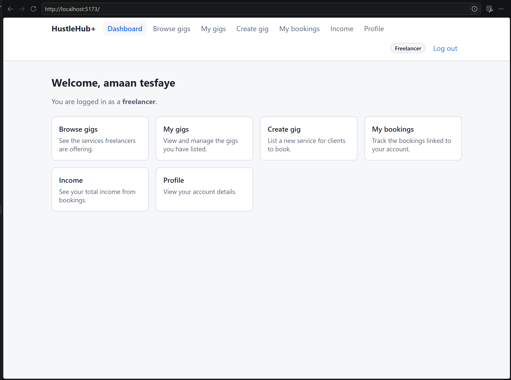

Login error:
 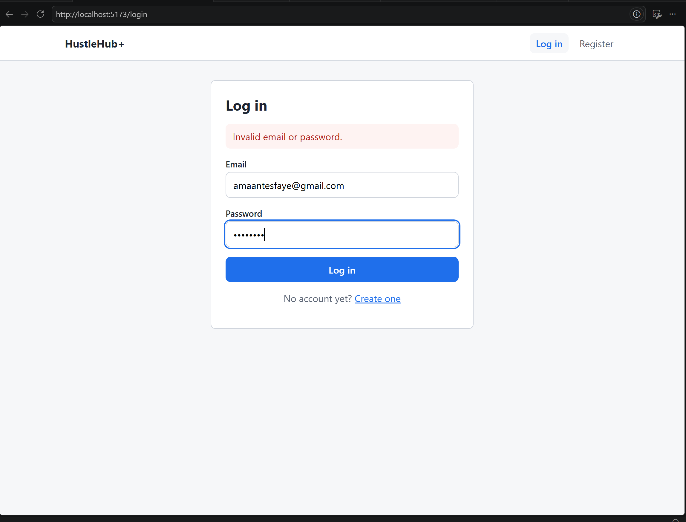

Not Allowed:
 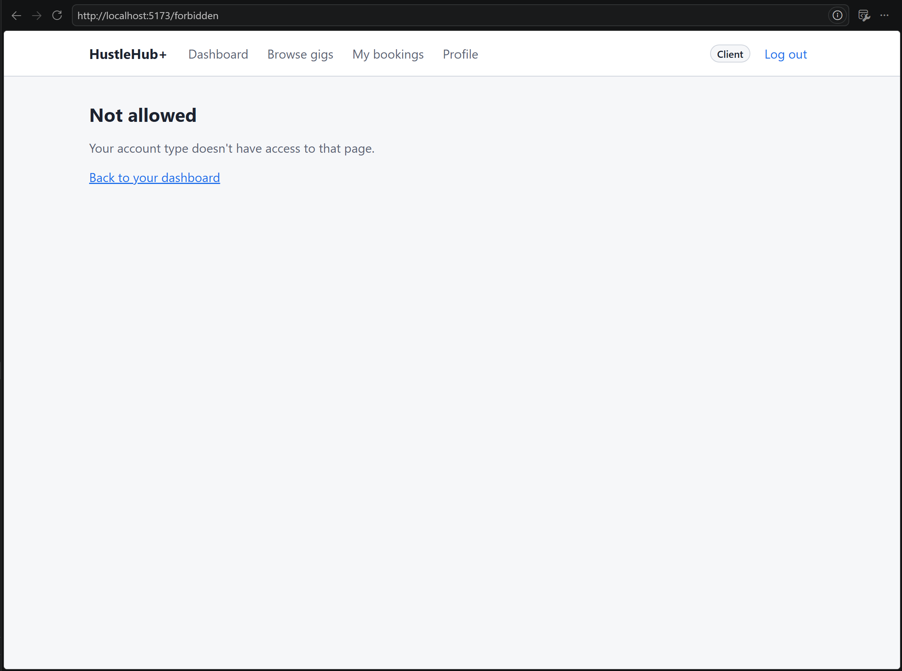

Register validation:
 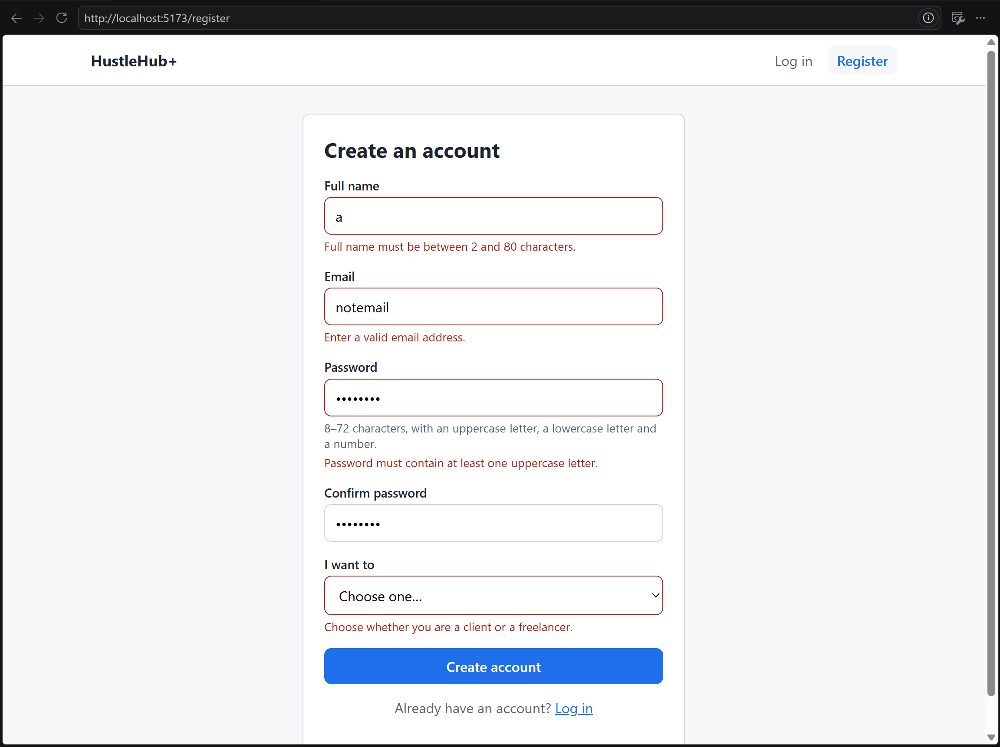

---

## References

Dworkin, M. 2007. *Recommendation for Block Cipher Modes of Operation: Galois/Counter Mode (GCM) and GMAC*. NIST Special Publication 800-38D. Gaithersburg: National Institute of Standards and Technology. Available at: https://doi.org/10.6028/NIST.SP.800-38D [Accessed 8 November 2026].

Grassi, P.A., Fenton, J.L., Newton, E.M., Perlner, R.A., Regenscheid, A.R., Burr, W.E., Richer, J.P., Lefkovitz, N.B., Danker, J.M., Choong, Y.-Y., Greene, K.K. and Theofanos, M.F. 2017. *Digital Identity Guidelines: Authentication and Lifecycle Management*. NIST Special Publication 800-63B. Gaithersburg: National Institute of Standards and Technology. Available at: https://doi.org/10.6028/NIST.SP.800-63b [Accessed 8 November 2026].

M'Raihi, D., Bellare, M., Hoornaert, F., Naccache, D. and Ranen, O. 2005. *HOTP: An HMAC-Based One-Time Password Algorithm*. RFC 4226. Internet Engineering Task Force. Available at: https://www.rfc-editor.org/rfc/rfc4226 [Accessed 8 November 2026].

M'Raihi, D., Machani, S., Pei, M. and Rydell, J. 2011. *TOTP: Time-Based One-Time Password Algorithm*. RFC 6238. Internet Engineering Task Force. Available at: https://www.rfc-editor.org/rfc/rfc6238 [Accessed 8 November 2026].

OWASP Foundation. n.d.-a. *OWASP Top Ten Web Application Security Risks*. Available at: https://owasp.org/www-project-top-ten/ [Accessed 8 November 2026].

OWASP Foundation. n.d.-b. *Authentication Cheat Sheet*. Available at: https://cheatsheetseries.owasp.org/cheatsheets/Authentication_Cheat_Sheet.html [Accessed 8 November 2026].

OWASP Foundation. n.d.-c. *Multifactor Authentication Cheat Sheet*. Available at: https://cheatsheetseries.owasp.org/cheatsheets/Multifactor_Authentication_Cheat_Sheet.html [Accessed 8 November 2026].
Tests passing:
 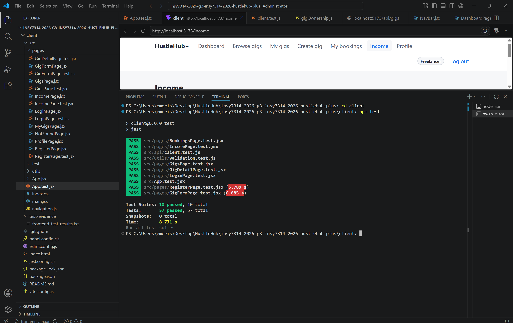

 South African Revenue Service (2026) *Rates of tax for individuals*. Available at: https://www.sars.gov.za/tax-rates/income-tax/rates-of-tax-for-individuals/ (Accessed: 7 November 2026).

South African Revenue Service (2026) *Budget 2026 Frequently Asked Questions*. Available at: https://www.sars.gov.za/about/sars-tax-and-customs-system/budget/budget-2026-frequently-asked-questions (Accessed: 7 November 2026).

